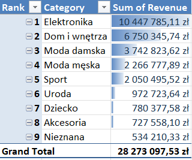
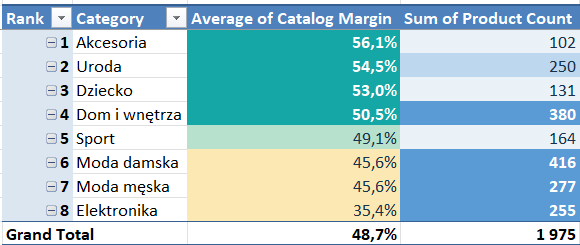
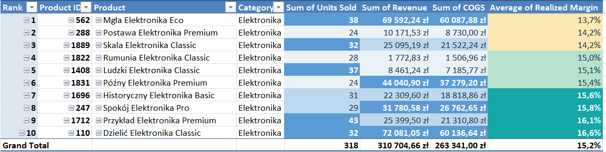
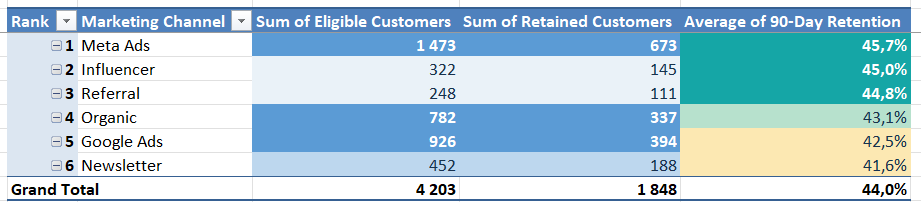
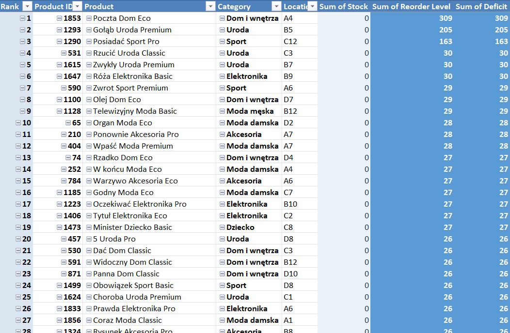
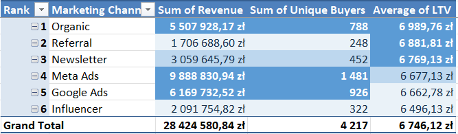
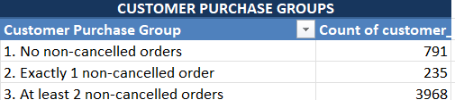
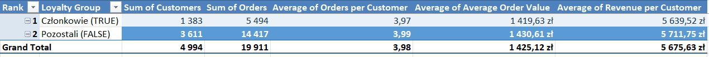
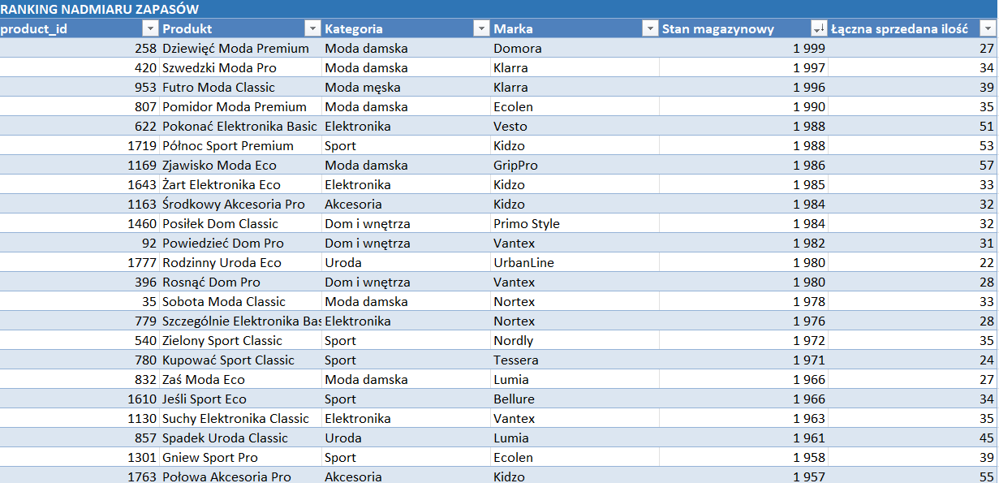

# ShopFlow – E-commerce Data Analysis

## 🎯 Project Objective

The objective of this project was to analyze sales data from the **ShopFlow** online store and prepare the data for reliable business analysis.

The project included:

- identifying and resolving data quality issues;
- sales analysis;
- customer and product analysis;
- seasonality analysis;
- inventory analysis.


## 📚 Table of Contents

  - [📚 Table of Contents](#-table-of-contents)
  - [🗂️ Data](#️-data)
    - [Main Data Areas](#main-data-areas)
  - [🧹 Data Preparation](#-data-preparation)
  - [🔧 Tools and Technologies](#-tools-and-technologies)
  - [Business Context](#business-context)
  - [🚨 Main Business Challenges](#-main-business-challenges)
  - [🧹 Business Analysis](#-business-analysis)
    - [1. Which Product Categories Generate the Most Revenue?](#1-which-product-categories-generate-the-most-revenue)
    - [2. Which Categories Have the Highest and Lowest Percentage Margins?](#2-which-categories-have-the-highest-and-lowest-percentage-margins)
    - [3. Which Products Have High Sales but Low Margins?](#3-which-products-have-high-sales-but-low-margins)
    - [4. Which Customers Return Most Often?](#4-which-customers-return-most-often)
    - [5. Which Products Are at Risk of Going Out of Stock?](#5-which-products-are-at-risk-of-going-out-of-stock)
    - [6. Which Marketing Channel Generates Customers with the Highest LTV?](#6-which-marketing-channel-generates-customers-with-the-highest-ltv)
    - [7. How Many Customers Make Only One Purchase and Never Return?](#7-how-many-customers-make-only-one-purchase-and-never-return)
    - [8. Do Loyalty Program Members Purchase More Frequently and Spend More?](#8-do-loyalty-program-members-purchase-more-frequently-and-spend-more)
    - [9. Which Products Have the Longest Inventory Holding Time?](#9-which-products-have-the-longest-inventory-holding-time)
  - [💡 Summary](#-summary)

---

## 🗂️ Data

The data comes from a simulated ShopFlow online store and contains five tables. The analysis covers a period of 24 months.

| Table | Number of records | Contents |
|---|---:|---|
| `customers` | ~5,000 | Customer data: location, acquisition channel, registration date and loyalty program membership |
| `products` | ~2,000 | Product catalog: category, brand, price, cost and product launch date |
| `orders` | ~20,000 | Order headers: customer, date, status, payment method, value and marketing channel |
| `order_items` | ~49,000 | Order line items: product, quantity, price at the time of purchase and discount |
| `inventory` | 2,000 | Inventory levels: stock quantity, reorder threshold and warehouse location |

### Main Data Areas

- customers;
- products;
- orders;
- order items;
- inventory levels.

## 🧹 Data Preparation

Before the business analysis began, a comprehensive data quality review was carried out across all tables. The process focused on identifying and handling issues that could affect the reliability of the results.

The data preparation process included:

- removing and merging duplicate records while preserving related history;
- handling missing data and values requiring additional verification;
- standardizing date, phone number, email address and text formats;
- correcting spelling mistakes and inconsistent category and location names;
- identifying invalid and unusual values;
- detecting outliers using the IQR method;
- fixing selected data integrity issues between tables;
- preserving historical records where removing them could result in the loss of important information.

As a result, a consistent and structured dataset was prepared for further analysis.

The data-cleaning process was performed using **PostgreSQL** and **SQL** and is available in a separate project:

[ShopFlow E-commerce Data Cleaning Project](https://github.com/Arturstrag/ShopFlow-E-commerce-Data-Cleaning-Project)

## 🔧 Tools and Technologies

- **Microsoft Excel** – data analysis and presentation of results;
- **Copilot** – support in creating and optimizing queries.

## Business Context

ShopFlow Sp. z o.o. is an online store operating in the Polish e-commerce market since 2021.

| Parameter | Value |
|---|---|
| Industry | E-commerce – fashion, home and interiors, consumer electronics and beauty |
| Market | Poland, domestic deliveries, no international expansion yet |
| Business model | B2C, online-only sales through the company’s own store and an Allegro integration |
| Customers in the database | Approximately 5,000 active accounts in the workshop dataset; in reality, ShopFlow has approximately 38,000 registered customers |
| Number of orders | Approximately 20,000 orders from the previous 12 months |
| Product catalog | Approximately 2,000 SKUs across 8 categories |
| Average order value (AOV) | PLN 187 |
| Team | 34 employees covering e-commerce, marketing, logistics and customer service, with a one-person analytics team |
| Headquarters and warehouse | Poznań |

## 🚨 Main Business Challenges

ShopFlow faces several key business challenges that limit further growth:

1. **Increasing customer acquisition costs.** Customer acquisition cost (CAC) increased by **34% year over year**, while the marketing team lacks a clear view of which channels generate the most valuable customers.
2. **Low customer retention.** According to the original business assumptions, only approximately **22% of customers** place a second order within six months of their first purchase.
3. **Inventory management issues.** The most popular products are frequently out of stock, leading to lost sales. At the same time, some products remain in inventory for many months and generate additional storage costs.
4. **Limited visibility into profitability.** The company had not previously carried out a comprehensive analysis of profitability by product category, making pricing and purchasing decisions more difficult.
5. **Inconsistent data across departments.** Marketing, sales and logistics use different reports and metrics, so decisions are often based on different interpretations of the data.
6. **CAC — Customer Acquisition Cost** – the average cost of acquiring one new customer.
7. **Retention** – the percentage of customers who return to make another purchase.

## 🧹 Business Analysis

ShopFlow operates across several product categories. The management team wanted to better understand what actually drives business performance: which categories generate revenue, where margin is created, why customers return or fail to return, and whether inventory is being managed effectively.

The goal was not simply to prepare tables and charts. The most important objective was to identify which problems genuinely required business intervention.

Each analysis therefore followed the same structure:

1. define a specific business question;
2. establish the calculation method;
3. verify the result;
4. distinguish observations from recommendations.

The analysis used data from the `customers`, `products`, `orders`, `order_items` and `inventory` tables. Depending on the question, the data was joined using keys such as `customer_id` and `product_id`.

Order statuses and data quality were also taken into account. For example, cancelled orders were not treated as completed purchases.

### 1. Which Product Categories Generate the Most Revenue?

The first step was to identify which product categories are the most important sources of revenue. This question was intended to help determine where the store should focus its marketing and sales activities.

Revenue was calculated for each order line using data from the `order_items` and `products` tables. The calculation included the number of units sold, the price at the time of purchase and the discount applied to the customer.

```text
revenue =
quantity × unit_price_at_order × (1 − discount_pct / 100)
```

The order items were joined with the product catalog using `product_id`. Revenue was then aggregated by category. The **“Unknown”** category was excluded because its items could not be reliably assigned to a valid category.



**Electronics** generated **PLN 10,447,785.11**, representing approximately **38%** of the revenue included in the analysis. The combined revenue of the eight analyzed categories amounted to **PLN 27,738,887.20**.

At the other end of the scale were **Accessories**, with revenue of **PLN 727,558.10**.

**Observation:** Electronics is ShopFlow’s most important revenue-generating category. However, revenue alone does not indicate whether this category is the most profitable.

**Business recommendation:** Electronics should be prioritized in the marketing budget and featured prominently on the store’s homepage. Decisions should not be based on revenue alone. The result should also be analyzed together with margin, discounts and returns.

### 2. Which Categories Have the Highest and Lowest Percentage Margins?

High revenue does not necessarily mean high profit. Therefore, the next question focused on the profitability of individual product categories.

Percentage margin shows what share of the selling price remains after covering the purchase or production cost of a product.

```text
percentage margin =
(unit_price − unit_cost) / unit_price × 100%
```

Products with a price equal to zero were excluded. The average margin was then calculated for each category, excluding the **“Unknown”** category.



Electronics achieved an average margin of **35.4%**, while the highest margin was recorded for Accessories at **56.1%**.

**Observation:** Electronics is the category with the highest revenue but also the lowest margin. Its margin is more than 10 percentage points below the average. Accessories have the opposite profile: low revenue but the highest margin.

**Business recommendation:** Management should receive a combined revenue and margin analysis by category. Electronics and Accessories should be treated as complementary areas.

Electronics can generate traffic and sales volume, while Accessories can increase the margin of the entire basket. Cross-selling accessories to customers purchasing electronics should be tested.

### 3. Which Products Have High Sales but Low Margins?

The category analysis showed that Electronics is the most problematic category in terms of the relationship between revenue and margin. The next step was to determine whether this issue affected the entire category or only selected products.

A ranking of the 10 products with the lowest realized margins was prepared. Only products sold in quantities greater than 20 units were included.

The `order_items` and `products` tables were joined using `product_id`.

For each product, the following metrics were aggregated:

- number of units sold;
- revenue after discounts;
- cost of goods sold;
- realized percentage margin.

```text
revenue after discount =
quantity × unit_price_at_order × (1 − discount_pct / 100)
```

```text
cost of goods sold = quantity × unit_cost
```

```text
realized margin =
(revenue after discount − cost of goods sold)
/
revenue after discount
× 100%
```



All 10 products with high sales and the lowest realized margins belonged to Electronics. Their realized margins ranged from **13.7% to 16.6%**, significantly below the catalog margin for Electronics of **35.4%**.

**Observation:** Products with high sales and low margins are concentrated in Electronics. Discounts further reduce their realized margins, meaning that the most popular products are not necessarily the most profitable.

**Business recommendation:** The first step should be to analyze these 10 specific products rather than changing the strategy for the entire category.

Purchase prices should be renegotiated for these SKUs. At the same time, the discount policy should be reviewed, because routinely applying additional discounts to products with low catalog margins may further weaken their profitability.

### 4. Which Customers Return Most Often?

Management assumed that ShopFlow’s main problem was low customer retention. To verify this assumption, the analysis examined how many customers made a second purchase within 90 days.

Orders with the `Cancelled` status were excluded because a cancelled order is not treated as a completed purchase.

For each customer:

- completed orders were sorted chronologically;
- the date of the first purchase was identified;
- the date of the second purchase was identified;
- the number of days between the first and second purchases was calculated.

```text
days to second purchase =
second purchase date − first purchase date
```

A customer received a value of 1 if the second purchase took place within 90 days. Otherwise, the customer received a value of 0.

```text
90-day retention =
number of customers with a second purchase within 90 days
/
number of customers with a first purchase
× 100%
```

Customers were then joined with the `customers` table to analyze the results by acquisition channel.



Overall, **44.0% of customers** who completed at least one purchase made a second purchase within 90 days. This result was twice as high as the management target of **22%**.

The highest retention was observed among customers acquired through Meta Ads and Influencer channels, while the lowest retention was recorded for the Newsletter channel.

**Observation:** The data did not confirm that the main problem was a lack of returning customers. Among customers who made a first purchase, 90-day retention was **44%**.

A more important issue was that some registered customers never made their first purchase.

**Business recommendation:** Management should measure activation in addition to retention. Activation means the percentage of registered customers who complete their first purchase.

Because Newsletter customers had the lowest retention and did not stand out in terms of LTV, the marketing team should also check whether the database of approximately **61,000 subscribers** is properly segmented.

### 5. Which Products Are at Risk of Going Out of Stock?

The analysis used the `inventory` and `products` tables joined by `product_id`.

Products were classified as being at risk when both conditions were met:

```text
is_active = TRUE
```

```text
stock_quantity ≤ reorder_level
```

For each selected product, the potential shortage was calculated as:

```text
shortage = reorder_level − stock_quantity
```



The analysis showed that **434 active products**, representing approximately **22% of the entire catalog**, were at or below their reorder threshold.

More than **15 products** had zero stock, including “Organ Moda Eco”, “Dziadek Uroda Basic” and “Warzywo akcesoria”.

**Result:** The problem does not concern only a few individual products. As many as **22% of the active catalog** required attention.

**Observation:** The scale of the risk points to a systemic issue in the replenishment process. The `reorder_level` threshold exists in the data, but it does not appear to be automatically connected to operational actions.

**Business recommendation:** ShopFlow should implement automated reorder alerts. Priority should be given to products with zero stock and products with strong historical sales.

### 6. Which Marketing Channel Generates Customers with the Highest LTV?

The analysis was expanded to include LTV, or Customer Lifetime Value.

LTV describes the total value of purchases generated by an average customer over the analyzed period.

For each channel, the following metrics were calculated:

- total `total_amount`;
- number of unique customers who placed at least one order;
- average purchase value per buyer.

```text
LTV =
total total_amount generated by the channel
/
number of unique buyers in the channel
```

Customers without any orders were excluded because they had not generated revenue.



LTV per customer ranged from **PLN 6,496** to **PLN 6,990**, with a spread of approximately **7%**.

Organic customers had the highest LTV at **PLN 6,990**, while Influencer customers had the lowest at **PLN 6,496**.

**Observation:** No channel clearly outperformed the others in terms of LTV. Meta Ads delivered a high volume of customers, but it did not generate customers with the highest average value. This is important because Meta Ads accounted for approximately **42% of marketing expenditure**.

**Business recommendation:** Budget allocation should not be based only on the number of acquired customers or on LTV. LTV should be compared with Customer Acquisition Cost, or CAC.

Campaign cost data was not included in the current ShopFlow dataset. This is an important analytical gap that should be addressed in the next stage.

### 7. How Many Customers Make Only One Purchase and Never Return?

The customer base was divided into three groups:

- customers with no completed orders;
- customers with exactly one completed order;
- customers with at least two completed orders.

The `customers` table was joined with the `orders` table using `customer_id`. Orders with the `Cancelled` status were excluded because they did not represent completed purchases.



As many as **791 registered customers**, representing **15.8% of the entire customer base**, had no completed orders.

At the same time, **94.4% of customers who made a first purchase returned at some point**.

**Observation:** The main issue is not low retention after the first purchase. The problem is that some registered customers never move from registration to their first transaction.

Management should distinguish between:

- customer activation, meaning encouraging a customer to make a first purchase;
- customer retention, meaning encouraging a customer to make subsequent purchases.

**Business recommendation:** The CRM team should prioritize an activation campaign targeting the **791 customers without any completed purchase**.

Possible actions include a time-limited welcome discount, a reminder about an incomplete shopping journey or a campaign tailored to the customer’s acquisition channel.

### 8. Do Loyalty Program Members Purchase More Frequently and Spend More?

ShopFlow Club had been operating for eight months.

Customers were divided into two groups:

```text
loyalty_member = TRUE
```

and:

```text
loyalty_member = FALSE
```

For each group, the following metrics were calculated:

- number of customers;
- number of orders;
- average number of orders per customer;
- average order value;
- average total revenue per customer.



ShopFlow Club members placed an average of **3.97 orders per customer**, had an average order value of **PLN 1,420** and generated average revenue of **PLN 5,640 per customer**.

For non-members, the corresponding figures were **3.99 orders**, **PLN 1,431 average order value** and **PLN 5,712 average revenue per customer**.

**Observation:** Based on the available data, loyalty program members did not purchase more frequently or spend more than non-members.

The differences were small, but all three analyzed metrics were slightly lower for loyalty program members.

**Business recommendation:** Before making further investments in ShopFlow Club, the analysis should be repeated for customers who have been members for at least three months.

If there is still no meaningful difference in this group, the program mechanics should be reviewed.

### 9. Which Products Have the Longest Inventory Holding Time?

Products with stock levels above 500 units were selected from the `inventory`, `products` and `order_items` tables. Their current stock was compared with the total number of units sold.



The analysis showed that **830 products**, representing more than **40% of the catalog**, had inventory levels above 500 units.

Examples included:

- “Dziewięć Moda Premium” — **1,999 units in stock**, only **27 units sold**;
- “Szwedzki Moda Pro” — **1,997 units in stock**, only **34 units sold**.

**Result:** A significant part of the catalog has inventory levels disproportionate to actual sales.

**Observation:** ShopFlow faces two simultaneous inventory problems. Some products are at risk of going out of stock, while others remain in excessive quantities.

This may indicate problems with demand forecasting, a lack of regular inventory turnover analysis or insufficient integration between purchasing decisions and historical sales.

**Business recommendation:** ShopFlow should introduce a regular inventory turnover report based on the relationship between current stock and sales over a defined period.

Products with the lowest turnover should be flagged for discounting, reduced future deliveries, transfer to another sales channel or withdrawal from the offer.

The inventory turnover report should be analyzed together with the out-of-stock risk report.

## 💡 Summary

The ShopFlow analysis helped verify key business assumptions and identify areas requiring further optimization.

Before the analysis began, the data was comprehensively cleaned and standardized. As a result, the conclusions were based on a consistent and reliable dataset.

The main findings are:

1. **ShopFlow’s main problem is activation, not retention.**

   **94.4% of customers who made a first purchase returned for another order**, while **15.8% of registered users never made a purchase**. Business activities should therefore focus on increasing activation rather than only improving retention.

2. **Electronics is a strategic but challenging category.**

   Electronics generates the highest revenue, but also has the lowest margin and the highest return rate. This calls for a separate strategy covering pricing, promotions, product assortment and quality control.

3. **The loyalty program currently shows no measurable impact on customer behavior.**

   After eight months of operation, program members do not outperform other customers in purchase frequency or customer value. Before further investment, the program should be evaluated in more detail.

4. **Inventory management and demand forecasting require improvement.**

   **22% of products are at risk of going out of stock**, while **40% of the catalog has excessive inventory levels**. The simultaneous occurrence of shortages and surpluses suggests a systemic problem with purchasing planning and inventory replenishment.

5. **Marketing channel evaluation should consider customer quality.**

   Although Meta Ads generates the highest volume of new customers, the LTV of customers acquired through this channel is not the highest. Budget allocation decisions should therefore consider both acquisition volume and long-term customer value.